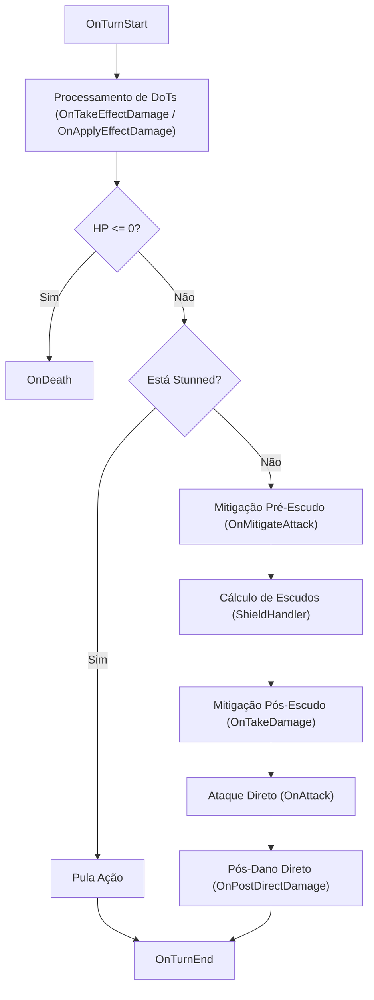
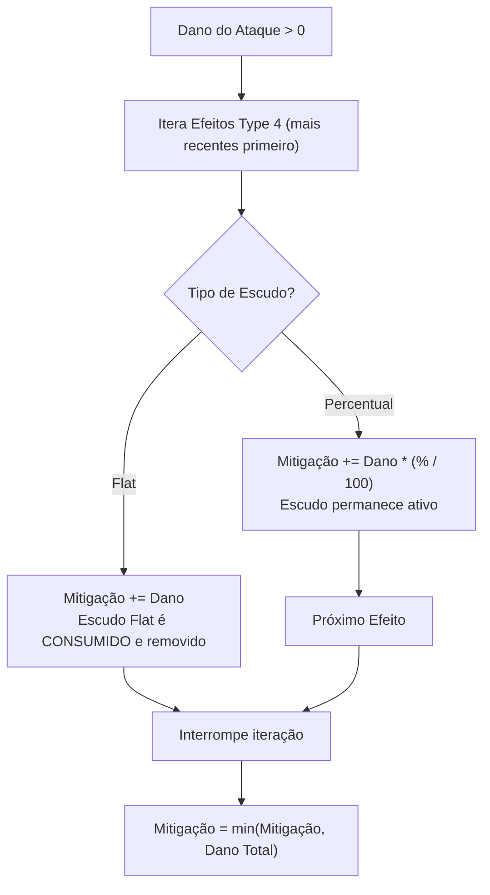
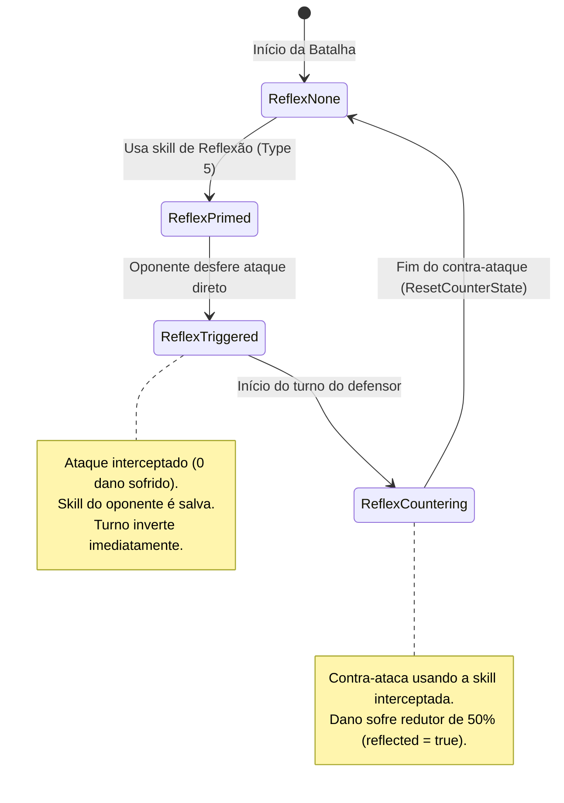
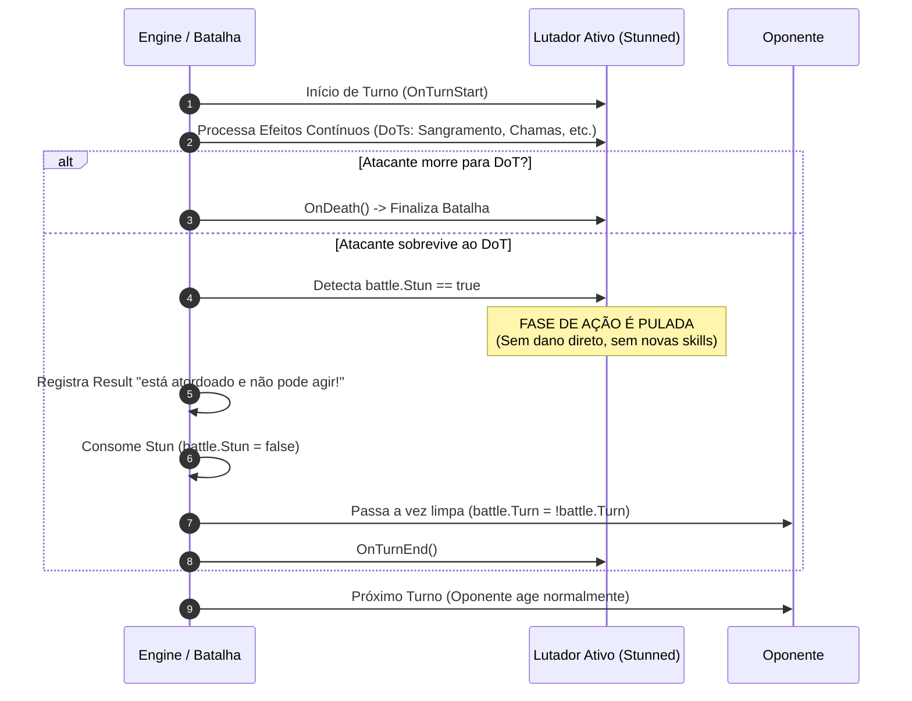

# 📖 Game Design Document (GDD) — Regras de Negócio e Mecânicas de Combate

> **Versão da Engine:** 2.0 (Headless / Data-Driven / Event-Driven)  
> **Status:** Documentação Oficial e Definitiva  

---

## 1. Fórmulas de Status e Progressão

Esta seção documenta a base matemática de atributos, cálculo de pontos de vida (HP) e escalonamento de nível dos combatentes. As fontes de verdade residem em [`resources/config/combat_config.json`](../resources/config/combat_config.json), [`src/rinha/battle.go`](../src/rinha/battle.go) e [`src/rinha/rinha.go`](../src/rinha/rinha.go).

### 1.1 Cálculo do Nível e Experiência (XP)

O nível de um galo é calculado de forma não linear a partir da experiência acumulada:

$$\text{Level}(\text{xp}) = \left\lfloor \sqrt{\frac{\text{xp}}{30}} \right\rfloor + 1$$

A experiência necessária para alcançar um determinado nível é calculada de forma inversa:

$$\text{XP}(\text{level}) = (\text{level} - 1)^2 \times 30 \quad (\text{para } \text{level} > 0)$$

---

### 1.2 Fórmula de Pontos de Vida (HP Inicial)

O cálculo de vida máxima e vida inicial de um lutador ao entrar em combate é executado pela função `InitFighter` em [`src/rinha/battle.go`](../src/rinha/battle.go):

$$\text{HP}_{\text{base\_calc}} = \text{BaseHP} + (\text{HPPerLevel} \times \text{Level}) + (\text{HPPerReset} \times \text{Resets}) + \text{Bônus}_{\text{Evolução}} + \text{Bônus}_{\text{Upgrades}} + (\text{Attributes}[0] \times \text{Mult}_{\text{Atributo}})$$

Valores numéricos carregados do arquivo de balanceamento:

| Parâmetro | Valor | Descrição |
|---|---|---|
| `BaseHP` | `100` | Vida base de qualquer combatente |
| `HPPerLevel` | `12` | Vida adicional concedida por nível do galo |
| `HPPerReset` | `45` | Vida adicional concedida por reset concluído |
| `EvolvedHPBonus` | `150` | Bônus concedido se o galo for evoluído (`Resets >= 10`) |
| `AttributeHPMultiplier` | `1.5` | Multiplicador de vida por ponto no `Attributes[0]` (Vitalidade) |
| `BasicTypeHPMultiplier` | `1.05` | Multiplicador de +5% de HP para galos do tipo elementar **Básico** |

#### Multiplicadores de HP Finais:
1. **Item de Vida Máxima (`ItemEffectIncreaseMaxHP`):**  
   $$\text{HP} = \text{round}(\text{HP} \times \text{itemPayload})$$
2. **Passiva do Galo Básico:**  
   Caso o tipo elemental do galo seja `Basic` (Básico), o HP total é multiplicado por `1.05` (+5%).

---

### 1.3 Bônus da Árvore de Upgrades do Jogador

A árvore de talentos/upgrades do usuário concede modificadores diretos no HP e no HP do oponente:

#### Bônus Próprios de Vida (Árvore `1`):
| Tier do Upgrade | Caminho | Bônus Flat | Total Cumulativo |
|---|---|---|---|
| Tier 1 | `[1]` | +35 HP | +35 HP |
| Tier 2 | `[1, 1]` | +35 HP | +70 HP |
| Tier 3 | `[1, 1, 1]` | +45 HP | +115 HP |
| Tier 4 | `[1, 1, 1, 0]` | +85 HP | **+200 HP** |

#### Reduções no HP Inicial do Oponente (Árvore `2, 1`):
Ao inicializar o combate em `CreateBattle`, se o jogador possuir upgrades na trilha de intimidação, o oponente tem sua vida atual e máxima reduzidas logo no início:

| Tier do Upgrade | Caminho | Redução no Adversário | Total Cumulativo |
|---|---|---|---|
| Tier 1 | `[2, 1]` | -10 HP | -10 HP |
| Tier 2 | `[2, 1, 1]` | -20 HP | -30 HP |
| Tier 3 | `[2, 1, 1, 0]` | -20 HP | **-50 HP** |

---

### 1.4 Escalonamento de Dano por Resets e Raridade Evoluída

O cálculo de dano base de qualquer habilidade (`CalcDamage`) leva em consideração o avanço de prestígio do galo:

1. **Bônus de Resets:**
   $$\text{Dano}_{\text{min/max}} = \text{Dano}_{\text{base}} \times (1 + 0.15 \times \text{Resets})$$
   *Cada reset concede +15% de dano base às habilidades.*

2. **Bônus de Raridade Evoluída:**
   Se o galo tiver sido ascendido em raridade (`EvolvedRarity > Rarity`), recebe um multiplicador cumulativo:
   - De Comum para Raro: **+15%**
   - De Raro para Épico: **+20%**
   - De Épico para Lendário: **+35%**
   - Acima de Lendário: **+60%**

---

## 2. Tabela de Vantagens e Fraquezas Elementais

O sistema elementar opera com uma matriz determinística $\mathcal{O}(1)$ externalizada em [`resources/config/type_advantages.json`](../resources/config/type_advantages.json). Existem 10 tipos elementais no jogo:

- **Multiplicador de Vantagem (+15%):** `1.15` (Ataque super efetivo 🔥)
- **Multiplicador de Desvantagem (-10%):** `0.90` (Ataque pouco efetivo 🧊)
- **Multiplicador Neutro:** `1.00`

### Matriz Completa de Vantagens (Atacante $\times$ Defensor)

| Atacante \ Defensor | Sombrio | Místico | Guerreiro | Radiante | Ilusão | Selvagem | Aquático | Ruína | Artesanal | Básico |
|---|:---:|:---:|:---:|:---:|:---:|:---:|:---:|:---:|:---:|:---:|
| **Sombrio (Shadow)** | 1.00 | **1.15** | 0.90 | 0.90 | 1.00 | 1.00 | 1.00 | **1.15** | 1.00 | 1.00 |
| **Místico (Mystic)** | 0.90 | 1.00 | **1.15** | **1.15** | 1.00 | 1.00 | 1.00 | 1.00 | 1.00 | 0.90 |
| **Guerreiro (Warrior)** | **1.15** | 0.90 | 1.00 | 1.00 | 0.90 | 1.00 | 1.00 | 1.00 | **1.15** | 1.00 |
| **Radiante (Radiant)** | **1.15** | 0.90 | 1.00 | 1.00 | **1.15** | 1.00 | 0.90 | 1.00 | 1.00 | 1.00 |
| **Ilusão (Illusion)** | 1.00 | 1.00 | **1.15** | 0.90 | 1.00 | **1.15** | 1.00 | 1.00 | 1.00 | 0.90 |
| **Selvagem (Wild)** | 1.00 | 1.00 | 1.00 | 1.00 | 0.90 | 1.00 | **1.15** | 0.90 | 1.00 | **1.15** |
| **Aquático (Aquatic)** | 1.00 | 1.00 | 1.00 | **1.15** | 1.00 | 0.90 | 1.00 | **1.15** | 0.90 | 1.00 |
| **Ruína (Ruin)** | 0.90 | 1.00 | 1.00 | 1.00 | 1.00 | **1.15** | 0.90 | 1.00 | **1.15** | 1.00 |
| **Artesanal (Craft)** | 1.00 | 1.00 | 0.90 | 1.00 | 1.00 | 1.00 | **1.15** | 0.90 | 1.00 | **1.15** |
| **Básico (Basic)** | 1.00 | **1.15** | 1.00 | 1.00 | **1.15** | 0.90 | 1.00 | 1.00 | 0.90 | 1.00 |

### Resumo das Relações de Pedra-Papel-Tesoura:
- **Sombrio:** Vence *Místico* e *Ruína*; Perde para *Radiante* e *Guerreiro*.
- **Místico:** Vence *Guerreiro* e *Radiante*; Perde para *Sombrio* e *Básico*.
- **Guerreiro:** Vence *Sombrio* e *Artesanal*; Perde para *Místico* e *Ilusão*.
- **Radiante:** Vence *Sombrio* e *Ilusão*; Perde para *Aquático* e *Místico*.
- **Ilusão:** Vence *Guerreiro* e *Selvagem*; Perde para *Radiante* e *Básico*.
- **Selvagem:** Vence *Aquático* e *Básico*; Perde para *Ruína* e *Ilusão*.
- **Aquático:** Vence *Ruína* e *Radiante*; Perde para *Selvagem* e *Artesanal*.
- **Ruína:** Vence *Selvagem* e *Artesanal*; Perde para *Aquático* e *Sombrio*.
- **Artesanal:** Vence *Básico* e *Aquático*; Perde para *Ruína* e *Guerreiro*.
- **Básico:** Vence *Ilusão* e *Místico*; Perde para *Selvagem* e *Artesanal*.

---

## 3. Sistema de Passivas (Strategy Pattern)

O sistema de passivas desacopla bônus elementais e características de classes únicas usando o Strategy Pattern em [`src/rinha/passives/`](../src/rinha/passives/). 

### 3.1 Ciclo de Vida da Interface `PassiveStrategy`

Qualquer passiva intercepta pontos específicos do fluxo de turno através dos seguintes hooks:

---

### 3.2 Bônus Elementais Passivos

Todo galo herda a passiva elemental vinculada ao seu `RoosterType`:

| Elemento | Struct | Hook Utilizado | Mecânica / Regra de Negócio |
|---|---|---|---|
| **Guerreiro** | `WarriorPassive` | `OnAttack` | Concede **+4% de dano direto** em todos os ataques. |
| **Selvagem** | `WildPassive` | `OnAttack` | Concede **+6% de dano direto** se a vida atual for menor que **35% do HP máximo**. |
| **Sombrio** | `ShadowPassive` | `OnAttack` | Concede **+8% de dano direto** na **primeira habilidade** desferida na luta. |
| **Ilusão** | `IllusionPassive` | `OnMitigateAttack` | Reduz em **12% o primeiro dano direto recebido** (aplicado antes do escudo). |
| **Artesanal** | `CraftPassive` | `OnTakeEffectDamage` | Reduz em **10% todo dano de efeitos contínuos (DoTs)** sofridos. |
| **Ruína** | `RuinPassive` | `OnApplyEffectDamage` | Aumenta em **+8% todo dano de efeitos contínuos (DoTs)** causados no oponente. |
| **Radiante** | `RadiantPassive` | `OnTakeEffectDamage` | Amplifica em **+12% a primeira cura ou escudo** recebido pelo lutador. |
| **Místico** | `MysticPassive` | `OnEffectChance` | Concede **+5% de chance adicional flat** para aplicar efeitos de status. |
| **Aquático** | `AquaticPassive` | `OnTurnEnd` | Ao terminar um turno com **40% ou menos de HP**, regenera **6% da vida máxima** (uma vez por batalha). |
| **Básico** | — | — | Não possui passiva de combate; recebe **+5% de vida máxima base** na inicialização. |

---

### 3.3 Passivas Exclusivas de Classes Únicas

Galos especiais ou míticos possuem habilidades passivas exclusivas registradas por ID e por nome canônico:

#### 1. Shield (ID: `61`)
- **`OnTakeDamage`:** Absorve **35%** de todo dano direto recebido (`absorbed = int(damage * 0.35)`), acumulando no pool interno `ShieldAbsorbed`. O dano real sofrido torna-se `damage - absorbed`.
- **`OnAttack`:** No próximo ataque direto do galo, todo o valor acumulado em `ShieldAbsorbed` é descarregado como dano adicional flat (`damage + absorbed`) e o pool é resetado para zero.

#### 2. Nephilim (ID: `63`)
- **`OnTurnStart`:** Incrementa um contador de turnos de Nefilim (`nephilimTurns++`).
- **`OnTakeDamage`:** Reduz permanentemente todo dano direto recebido pela metade (**50% de redução** pós-escudo).
- **`OnAttack`:** Amplifica o dano do ataque baseado no número de turnos decorridos:  
  $$\text{Dano} = \text{Dano} \times (1.0 + 0.2 \times \text{turnos})$$
  *(+20% de dano cumulativo a cada turno da luta).*

#### 3. Vortex (ID: `62`)
- **`OnPostDirectDamage` — Rasgo Vortal:** Imediatamente após desferir um ataque direto com dano $> 0$, causa **70% do dano direto** como dano residual extra, subtraindo diretamente da vida do alvo sem chance de bloqueio.

#### 4. Ctulhu (ID: `65`)
- **`OnApplyEffectDamage`:** A cada dano de efeito causado, aplica **1 stack de Corrupção** no alvo (limite de 45 stacks).
- **`OnAttack`:** Concede **+15% de dano direto por stack de Corrupção** presente no alvo:  
  $$\text{Dano} = \text{Dano} \times (1.0 + 0.15 \times \text{stacks})$$
- **`OnStealHeal`:** Quando o adversário realiza uma cura, Ctulhu **rouba 45% do valor da cura**, transferindo esse montante para sua própria vida e reduzindo a cura do oponente.

#### 5. Phoenix (ID: `33`)
- **`OnApplyEffectDamage`:** Ao aplicar dano por efeito contínuo (fogo/sangramento), cura a si mesmo em **220% do dano infligido** (`heal = damage * 2.2`), limitado ao HP máximo.

#### 6. Tempo (ID: `32`)
- **`OnDeath`:** Na primeira vez em que a vida chegar a 0, ressuscita imediatamente com **50% do HP máximo** (`MaxLife * 0.5`). Válido uma única vez por batalha.

#### 7. Lingering Will (ID: `66`)
- **`OnTakeEffectDamage`:** Possui **50% de chance** de anular integralmente qualquer dano de efeito contínuo (DoT).
- **`OnDeath`:** Ao receber um golpe fatal pela primeira vez, sobrevive com **1 de vida** e ativa o estado `LingeringLastStand`.
- **`OnAttack`:** Se o estado `LingeringLastStand` estiver ativo, o próximo ataque desfere **dano triplicado (3x)** e encerra o estado.

#### 8. Berseker (ID: `64`)
- **`OnAttack`:** Converte a porcentagem de vida perdida em poder de ataque destrutivo. Para cada 1% de HP perdido, ganha **+10% de dano**:  
  $$\text{mult} = 1.0 + \left( \frac{\text{MaxLife} - \text{Life}}{\text{MaxLife}} \times 100 \times 0.1 \right)$$

#### 9. Black (ID: `50`)
- **`OnAttack`:** Amplifica todo dano direto em **+70%** (`damage * 1.7`).
- **`OnApplyEffectDamage`:** Amplifica todo dano de efeitos contínuos em **+70%** (`damage * 1.7`).

#### 10. Graal (ID: `60`)
- **`OnAttack`:** A cada 3 ataques desferidos (`AttackCount % 3 == 0`), causa **dano quadruplicado (4x)**.

#### 11. White (ID: `51`)
- **`OnTakeEffectDamage`:** É **completamente imune** a qualquer dano de efeitos contínuos (DoT), retornando sempre 0 de dano.

---

## 4. Sistema de Itens

Os itens normais equipados pelos jogadores conferem propriedades mapeadas pelo enum strongly typed `ItemEffectType` em [`src/rinha/constants.go`](../src/rinha/constants.go):

| Enum | Nome Semântico | Fórmula Matemática | Descrição em Jogo |
|---|---|---|---|
| `1` | `ItemEffectIncreaseDamage` | $\text{Dano} = \text{round}(\text{Dano} \times \text{payload})$ | Aumenta o dano dos seus ataques diretos em $(\text{payload}-1) \times 100\%$. |
| `2` | `ItemEffectApplyStatus` | Rolagem $\ge 0.60$ (40% de chance) | Chance de aplicar o efeito de status de ID especificado no `payload`. |
| `3` | `ItemEffectIncreaseEffectChance` | $\text{Chance} = \text{Chance} + \text{payload}$ | Aumenta a probabilidade base de aplicar efeitos de habilidade em $\text{payload} \times 100\%$. |
| `4` | `ItemEffectIncreaseMaxHP` | $\text{HP} = \text{round}(\text{HP} \times \text{payload})$ | Aumenta a vida máxima do galo em $(\text{payload}-1) \times 100\%$. |
| `5` | `ItemEffectBlockDamage` | $\text{Dano} = \text{round}(\text{Dano} \times \text{payload})$ | Bloqueia $(1 - \text{payload}) \times 100\%$ do dano direto recebido (ex: payload 0.85 = 15% de bloqueio). |
| `6` | `ItemEffectIncreaseEffectDamage` | $\text{DoT} = \text{round}(\text{DoT} \times \text{payload})$ | Aumenta o dano dos efeitos contínuos aplicados em $(\text{payload}-1) \times 100\%$. |
| `7` | `ItemEffectReflectDamage` | $\text{Ricochete} = \text{round}(\text{Dano} \times \text{payload})$ | Reflete $\text{payload} \times 100\%$ de todo dano direto sofrido de volta para o atacante. |
| `8` | `ItemEffectTrainBonusXPPercent` | $\text{XP} = \text{XP} \times (1 + \text{payload})$ | Concede bônus percentual de XP durante o treino. |
| `9` | `ItemEffectTrainBonusXPFlat` | $\text{XP} = \text{XP} + 2$ | Concede +2 de XP fixo adicional por treino. |
| `10` | `ItemEffectClanXPBonus` | Rolagem aleatória | Chance de conceder +1 de XP extra para o clã do jogador durante o treino. |
| `11` | `ItemEffectHealModifier` | $\text{Cura} = \text{Cura} \times \text{payload}$ (Própria) $\text{Cura} = \text{Cura} \times (2 - \text{payload})$ (Oponente) | Aumenta a cura realizada pelo usuário e reduz a cura do oponente na mesma proporção. |
| `12` | `ItemEffectBlockEffectDamage` | $\text{DoT} = \text{round}(\text{DoT} \times \text{payload})$ | Bloqueia $(1 - \text{payload}) \times 100\%$ de dano de efeitos contínuos (DoTs). |

---

## 5. Mecânicas Core de Batalha

O motor de combate em [`src/rinha/round.go`](../src/rinha/round.go) e [`src/rinha/defense.go`](../src/rinha/defense.go) opera de forma determinística turno a turno.

### 5.1 Modificadores Globais e Primeiro Turno
- **Redução do 1º Turno:** No primeiríssimo round da batalha (`firstTurn == true`), o dano direto é reduzido em **50%** (`attack_damage = int(attack_damage * 0.5)`). Isso impede eliminações em turno único antes do início da estratégia.
- **Atributos de Usuário em Combate:**
  - `user.Attributes[1]` (Força): Concede **+0.2% de dano direto** por ponto: $(1 + 0.002 \times \text{Atributo}_1)$.
  - `user.Attributes[3]` (Dano de Efeito): Concede **+0.2% de dano em DoTs** por ponto: $(1 + 0.002 \times \text{Atributo}_3)$.
  - `user.Attributes[4]` (Regeneração): Regenera vida do atacante a cada ataque desferido: $+0.3 \times \text{Atributo}_4$.
- **Upgrades de Crítico:**
  - Upgrades na árvore `[2, 0, 1]` concedem **9% de chance** (ou **19%** com upgrade `[2, 0, 1, 0]`) de desferir acerto crítico.
  - O dano crítico básico é de **+20%** (`damage / 5`), duplicado para **+40%** com o upgrade `[2, 0, 1, 1]`.
- **Esquiva:**
  - Upgrades na árvore `[2]` concedem chance cumulativa de esquiva (2%, 4%, 7% até **9%** no Tier 4). Se o rolamento tiver sucesso, o golpe erra (`Dodge = true`) e o dano é zerado.

---

### 5.2 Escudos: Mitigação Flat vs. Percentual (`ShieldHandler`)

O [`ShieldHandler`](../src/rinha/defense.go) calcula a redução de dano dos efeitos defensivos (Type 4):

1. **Escudos Percentuais (`ShieldReductionPercent`):**
   - Configurados com texto de porcentagem (`%%`).
   - Reduzem uma fração do dano a cada ataque (`Between(Range) / 100.0 * Dano`).
   - **Persistência:** Permanecem ativos até o contador de turnos (`Turns`) expirar.
   - **Prevenção de Acúmulo:** Ao aplicar um novo escudo percentual, `RemovePercentageShields` descarta proteções percentuais anteriores para evitar reduções de 100% cumulativas.
2. **Escudos Flat (`ShieldReductionFlat`):**
   - Absorvem **100% de um único golpe** direto.
   - **Consumo:** Após absorver o golpe, o efeito é imediatamente removido da lista de efeitos do lutador (`Target.Effects`).

---

### 5.3 Máquina de Estados de Reflexo (`ReflexHandler`)

O efeito de Reflexão de Habilidades (Type 5) opera como uma máquina de estados finitos (`ReflexState`):

1. **`ReflexStateNone (0)`:** Combate em andamento normal.
2. **`ReflexStatePrimed (1)`:** O lutador utilizou uma habilidade defensiva de reflexo. Fica em postura defensiva aguardando o ataque do oponente.
3. **`ReflexStateTriggered (2)`:** Quando o oponente executa um ataque contra a postura armada:
   - O ataque é **100% interceptado** (o defensor não recebe dano nem efeitos).
   - O identificador da habilidade é armazenado em `battle.ReflexSkill`.
   - A vez é invertida para o defensor.
4. **`ReflexStateCountering (3)`:** O defensor dispara a habilidade capturada de volta contra o agressor:
   - A flag `reflected` é ativada, aplicando o multiplicador de **50% de dano base** da skill (`attack_damage = int(attack_damage * 0.5)`).
   - Ao final do turno, `ResetCounterState` restaura o estado para `ReflexStateNone (0)` e a batalha segue o fluxo normal.

#### Ricochete Passivo de Itens (`ItemEffectReflectDamage`):
- O ricochete de itens reflete uma porcentagem do dano real sofrido.
- **Regra de Proteção:** O ricochete de item **nunca elimina o atacante diretamente**:  
  $$\text{DanoRefletido} = \min(\text{DanoRefletido}, \text{VidaDoAtacante} - 1)$$

---

### 5.4 Máquina de Estados de Fluxo de Turno e Atordoamento (Stun)

O atordoamento (Stun / Type 3) e os efeitos de dano contínuo (DoTs) operam sob um ciclo de fases estrito:

1. **Respeito aos Danos Contínuos (DoTs):**
   - Um lutador atordoado **não tem seu turno apagado nem o número da rodada decrementado**.
   - O lutador atordoado gasta o seu turno e sofre todos os ticks de dano contínuo (veneno, sangramento, fogo) ou cura ativa.
2. **Pulo da Fase de Ação:**
   - A execução de habilidades ativas, seleção de cartas e aplicação de dano direto são inteiramente ignoradas.
3. **Consumo e Liberação Limpa:**
   - O atordoamento dura exatamente **1 turno de ação**.
   - Ao final do turno atordoado, o Stun é consumido (`battle.Stun = false`), a vez passa para o adversário e a rodada avança de forma natural (1, 2, 3...).

